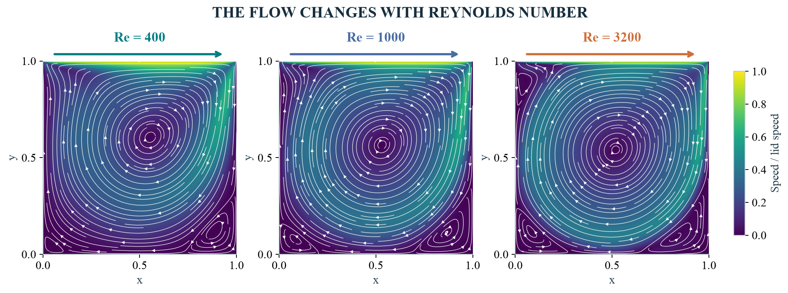
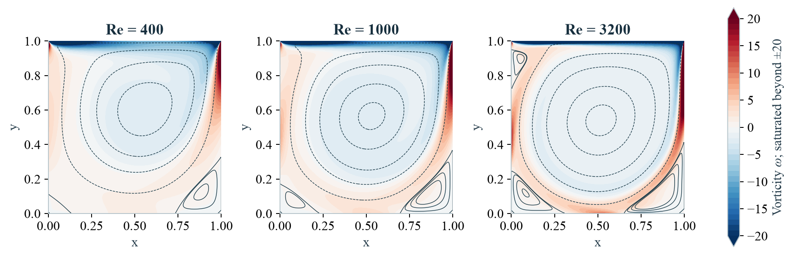
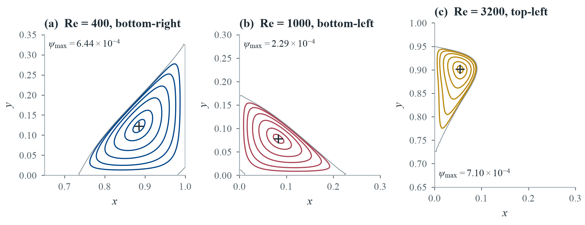
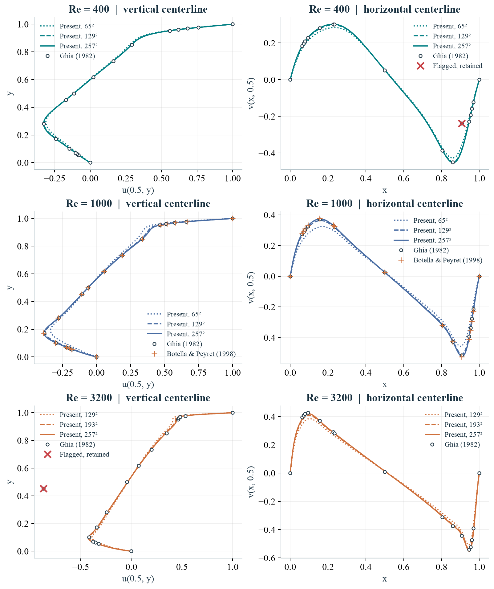
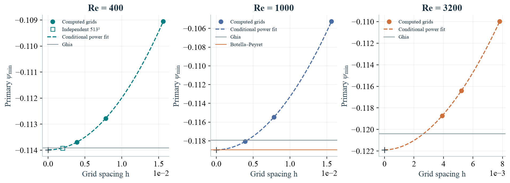
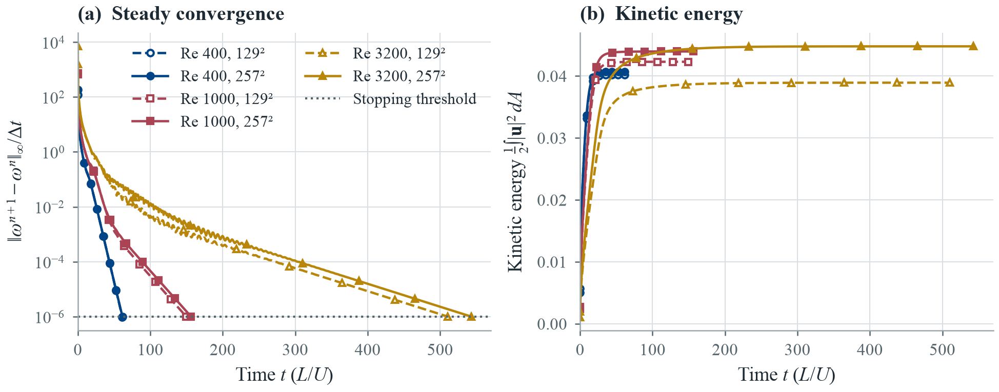
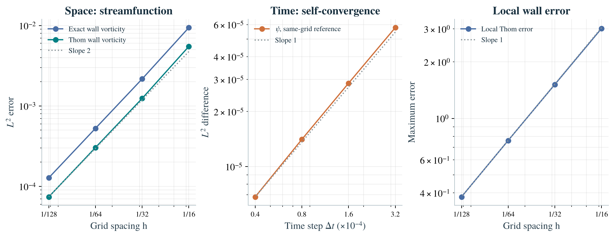

<div align="center">

# 2D Incompressible Navier-Stokes: The Lid-Driven Cavity

**A verified finite-difference solver for the classic CFD benchmark, with grid-convergence evidence, literature validation and animated visualizations.**

[](https://github.com/MarouTom/NS2D-Lid-Driven-Cavity/actions/workflows/tests.yml)


[](report/report.pdf)
[](notebooks/lid_driven_cavity.ipynb)
[](docs/animations.md)

<!-- Inline player: upload figures/cavity_particles.mp4 through GitHub's web editor and paste the
     resulting https://github.com/user-attachments/assets/... URL on its own line below this comment. -->
https://github.com/user-attachments/assets/09e60728-4480-42cf-a6fa-aa3f81e8e082


<sub>▶ <b><a href="figures/cavity_particles.mp4">Play the animation</a></b> (MP4, Manim) · Passive tracers advected through the converged steady velocity fields on 257² grids. Colour shows speed relative to the lid; all panels share one clock and one colour scale.</sub>

**[Illustrated report](report/report.pdf)** · **[Executed notebook](notebooks/lid_driven_cavity.ipynb)** · **[Reference data audit](docs/references.md)** · **[Accuracy study](docs/accuracy.md)** · **[How the animations are made](docs/animations.md)**

</div>

---

A square cavity is filled with fluid, and its top wall slides to the right at constant speed. Viscosity drags the adjacent fluid along, driving a large clockwise vortex and smaller counter-rotating eddies in the corners. This project solves for that flow from the 2-D incompressible Navier-Stokes equations, then **measures** how good the answer is: manufactured-solution convergence, three-grid Richardson estimates, an independent fourth grid, time-step refinement, and comparison with two published benchmarks.

### At a glance

| | Measured value | Evidence |
|---|---|---|
| **Spatial order** (manufactured solution, ψ and ω) | 2.04 on the finest grid pair | [verification.json](data/verification.json) |
| **Temporal order** (backward-Euler diffusion, explicit convection) | 1.02 - 1.05 | [verification.json](data/verification.json) |
| **Primary vortex**, Re = 1000, 257² | ψ<sub>min</sub> = −0.118074 · 0.12 % from Ghia et al. | [validation.json](data/validation.json) |
| **Grid uncertainty** of ψ<sub>min</sub> (conditional GCI) | 0.33 % · 0.94 % · 3.32 % at Re = 400 · 1000 · 3200 | [accuracy.json](data/accuracy.json) |
| **Discrete divergence** of every production field | ≤ 1.5 × 10⁻¹⁴ | [validation.json](data/validation.json) |
| **Production runs** | 9 integrations from rest, plus an independent 513² check | [run records](data/) |

<details>
<summary><b>Contents</b></summary>

- [How the circulation develops](#how-the-circulation-develops)
- [Gallery](#gallery)
- [The model](#the-model)
- [Numerical choices and their tradeoffs](#numerical-choices-and-their-tradeoffs)
- [Try it](#try-it)
- [Verification: measure the approximation](#verification-measure-the-approximation)
- [Results: compare the flow with the literature](#results-compare-the-flow-with-the-literature)
- [Scientific acceptance checklist](#scientific-acceptance-checklist)
- [Reading the figures](#reading-the-figures)
- [Reproduce and extend](#reproduce-and-extend)
- [Contributing and citation](#contributing-and-citation)

</details>

## How the circulation develops

<p align="center">
<!-- Inline player: upload figures/cavity_startup.mp4 through GitHub's web editor and paste the
     resulting https://github.com/user-attachments/assets/... URL on its own line below this comment. -->

https://github.com/user-attachments/assets/181addc3-0449-4acb-8039-54ebb8ac036f


<br><sub>▶ <b><a href="figures/cavity_startup.mp4">Play the animation</a></b> (MP4, Manim)</sub>
</p>

The lid starts moving at **t = 0**. Watch motion spread from the upper wall into the interior as the main vortex forms. The left panel shows speed and instantaneous streamlines; the right shows signed vorticity, which measures local rotation. The strip underneath plots the kinetic energy recorded by the solver; it climbs toward the dashed steady-state value. Every colour scale stays fixed throughout.

These are the **first 20 dimensionless time units of the actual Re = 400 simulation**, on a 129² grid. Recorded snapshots are interpolated in time for smooth playback (the energy curve is not interpolated). The vorticity colour scale saturates at ±20 to reveal the interior. The calculation continues to approximately t = 61.4 before meeting the steady criterion. [How the animations are made](docs/animations.md).

## Gallery

<table>
<tr>
<td width="50%"><a href="figures/flow_atlas.png"></a><br><sub><b>Flow atlas.</b> Final 257² streamlines and speed at the three Reynolds numbers, on a common scale.</sub></td>
<td width="50%"><a href="figures/vorticity.png"></a><br><sub><b>Vorticity.</b> Signed vorticity with streamfunction contours; the singular lid corners saturate the scale.</sub></td>
</tr>
<tr>
<td><a href="figures/corner_eddies.png"></a><br><sub><b>Corner eddies.</b> One counter-rotating secondary vortex per Re, with its centre and peak ψ; the top-left eddy appears at Re = 3200.</sub></td>
<td><a href="figures/centerlines.png"></a><br><sub><b>Centrelines.</b> u(y) and v(x) through the cavity centre against published reference stations.</sub></td>
</tr>
<tr>
<td><a href="figures/grid_convergence.png"></a><br><sub><b>Grid convergence.</b> Three-grid sequences and conditional Richardson extrapolation.</sub></td>
<td><a href="figures/residuals.png"></a><br><sub><b>Convergence history.</b> Residuals decay to the common 10⁻⁶ criterion while kinetic energy plateaus; Re = 3200 settles slowest.</sub></td>
</tr>
</table>

## The model

A viscous incompressible fluid fills a unit square. The upper wall moves right with unit speed; the other walls are stationary. In the vorticity-streamfunction formulation,

$$
\frac{\partial\omega}{\partial t}
+\frac{\partial\psi}{\partial y}\frac{\partial\omega}{\partial x}
-\frac{\partial\psi}{\partial x}\frac{\partial\omega}{\partial y}
=\frac{1}{\mathrm{Re}}\Delta\omega,
\qquad -\Delta\psi=\omega,
$$

with $u=\psi_y$, $v=-\psi_x$ and $\mathrm{Re}=UL/\nu$. The streamfunction enforces incompressibility; taking the curl removes pressure. No-slip enters through the wall vorticity.

| Quantity | Scale | Dimensionless range |
|---|---|---|
| Length | cavity side L | x, y ∈ [0, 1] |
| Velocity | lid speed U | lid u = 1; other walls u = v = 0 |
| Time | L / U (one lid-travel time) | t ≥ 0, flow starts from rest |
| Vorticity | U / L | sign convention: negative = clockwise |
| Reynolds number | UL / ν | 400, 1000, 3200 in the production study |

## Numerical choices and their tradeoffs

| Choice | Why use it? | What it costs |
|---|---|---|
| Uniform finite-difference grid | Simple stencils and a separable Poisson operator | Thin wall layers need fine grids |
| Centered second-order space differences | Clear consistency analysis, little artificial diffusion | Under-resolved oscillations are possible |
| Explicit convection, implicit diffusion | Two reusable SPD linear systems per step | First-order time accuracy; lagged walls still restrict the step |
| Thom wall vorticity | Transfers the tangential no-slip condition to vorticity | First-order local wall truncation error |
| Sine-transform linear solver | Direct solution of the discrete systems in O(M log M) | Requires the uniform rectangular geometry |

Sparse LU and conjugate gradient with an incomplete-Cholesky preconditioner are also available. [The report](report/report.pdf) derives the formulas, including the wall terms and the time-step restrictions.


> [!NOTE]
> **Why not a spectral code such as FluidSim?** [FluidSim](https://fluidsim.readthedocs.io/) is designed around *periodic* pseudospectral solvers. The cavity has four no-slip walls and singular lid corners, so periodic Fourier bases do not apply without immersed-boundary or penalisation terms that would add their own error. FluidSim's scientific acceptance gate is still a useful standard, so this repository is checked against it [below](#scientific-acceptance-checklist).

## Try it

From this folder, create a virtual environment and install the project:

```bash
python3 -m venv .venv
source .venv/bin/activate
python -m pip install -e ".[dev,notebook]"
python scripts/run_demo.py
```

On Windows, activate with `.venv\Scripts\Activate.ps1`. The demo runs Re = 400 on a 65² grid and writes a figure and restart checkpoint to `output/demo/`. This small run is intended for exploration; the production study uses finer grids.

The same calculation through the Python API:

```python
from ns2d import Grid, Cavity, Solver
from ns2d.postproc import primary_vortex

solver = Solver(Grid.square(65), Cavity(Re=400), backend="dst")
result = solver.run(T=80.0, steady_tol=1e-6, record=False)

print("Steady criterion met:", result.converged)
print("Final residual:", result.final_residual)
print(primary_vortex(solver.psi, solver.grid))
solver.save("checkpoint.npz")
```

## Verification: measure the approximation

The manufactured solution contains two spatial modes and moving walls, so it exercises both nonlinear convection and the lid-forcing mechanism. The spatial study runs to T = 0.5 at Re = 100, long enough for vorticity generated at the walls to diffuse into the interior; over a much shorter horizon the streamfunction error would be almost entirely the Poisson discretisation error of the initial vorticity. Separate space and time studies show approximately second-order accuracy in space for both streamfunction and vorticity, with exact and Thom wall vorticity, and first-order accuracy in time. Local Thom wall error is first order. The full sequences are retained in [verification.json](data/verification.json). An asymmetric manufactured field and a doubled-step check on the finest grid independently challenge the spatial study.

| Study | Refinement | Observed order (ψ, L²) | Observed order (ω, L²) |
|---|---|---:|---:|
| Space, exact wall vorticity | h = 1/16 → 1/128, fixed dt | 2.12 → 2.04 → 2.04 | 2.11 → 2.04 → 2.04 |
| Space, Thom wall vorticity | h = 1/16 → 1/128, fixed dt | 2.15 → 2.03 → 2.04 | 2.14 → 2.04 → 2.04 |
| Space, asymmetric field | h halved twice | 2.29 → 2.00 | 2.87 → 2.08 |
| Time, Thom walls | dt halved three times, N = 65 | 1.01 → 1.02 → 1.05 | 1.01 → 1.02 → 1.05 |
| Joint, dt ∝ h² | both refined | 2.15 → 2.03 | 2.15 → 2.03 |

<details>
<summary>View the spatial, temporal and wall-convergence plots</summary>



</details>

Tests also check the Poisson equation, discrete divergence and circulation, agreement between the three linear solvers, instability detection, and checkpoint compatibility. These identities test algebraic consistency; they do not replace an accuracy study.

```bash
python -m pytest -q
```

## Results: compare the flow with the literature

<!-- results:start -->
| Re | Grid | Final time | Residual | Steady? | ψ minimum | Ghia difference |
|---:|---:|---:|---:|:---:|---:|---:|
| 400 | 65² | 61.12 | 9.80e-07 | yes | -0.109052 | 4.26% |
| 400 | 129² | 61.37 | 9.68e-07 | yes | -0.112776 | 0.99% |
| 400 | 257² | 61.62 | 9.88e-07 | yes | -0.113689 | 0.19% |
| 1000 | 65² | 140.00 | 9.97e-07 | yes | -0.105252 | 10.75% |
| 1000 | 129² | 149.70 | 9.98e-07 | yes | -0.115473 | 2.08% |
| 1000 | 257² | 156.40 | 9.97e-07 | yes | -0.118074 | 0.12% |
| 3200 | 129² | 510.66 | 1.00e-06 | yes | -0.109979 | 8.64% |
| 3200 | 193² | 534.75 | 1.00e-06 | yes | -0.116413 | 3.29% |
| 3200 | 257² | 543.11 | 1.00e-06 | yes | -0.118734 | 1.37% |
<!-- results:end -->

The residual is the maximum interior vorticity update divided by the time step. The stopping threshold is 10⁻⁶. “Ghia difference” is the relative difference in primary-vortex streamfunction, not an error bound for the full flow.

<details>
<summary>View the velocity profiles against the published reference stations</summary>


</details>

The references are [Ghia, Ghia & Shin (1982)](https://doi.org/10.1016/0021-9991(82)90058-4), plus [Botella & Peyret (1998)](https://doi.org/10.1016/S0045-7930(98)00002-4) at Re = 1000. Their different methods make the second comparison useful. Both sets of discrepancies are exported in [validation.json](data/validation.json). Agreement with one reference is not a continuum accuracy estimate.

> [!IMPORTANT]
> **Reference anomalies stay visible.** The headline RMS includes every published station. Ghia’s printed u = −0.86636 at Re = 3200, y = 0.4531, and v = −0.23827 at Re = 400, x = 0.9063, are flagged, retained, and accompanied by secondary RMS values without those stations. They are never replaced with values fitted to this solver. [Read the source audit and coordinate conventions](docs/references.md).

### What the measurements establish

- Increasing Re sharpens the wall layers and moves the primary vortex toward the cavity centre. Secondary corner eddies become more visible.
- Three grids per Reynolds number measure spatial sensitivity. The primary-vortex strength, vortex coordinates, energy, center vorticity and a secondary eddy are assessed separately.
- Every production state reaches the same steady criterion. Two further ten-time-unit integrations, with dt and dt/2, measure the remaining drift and step sensitivity.
- The upper corners are singular. Colour limits are stated on vorticity figures; large corner values are not removed from the underlying data.
- The suggested time step combines an interior linear analysis with a small-grid Stokes wall experiment. It is not a nonlinear stability theorem.

### Grid uncertainty, time accuracy and settling

The spatial study uses 65²/129²/257² grids at Re = 400 and 1000, and 129²/193²/257² at Re = 3200. Conditional Richardson fits use the actual grid ratios. Non-monotone sequences are retained without an invented order or uncertainty estimate.

<!-- accuracy:start -->
| Re | Three-grid fitted order | Conditional GCI for ψ minimum | Ten-time-unit ψ drift |
|---:|---:|---:|---:|
| 400 | 2.027 | 0.327% | 1.830e-05% |
| 1000 | 1.974 | 0.941% | 7.603e-05% |
| 3200 | 1.917 | 3.321% | 7.843e-05% |

GCI is a conditional power-law estimate, not a rigorous bound. Settling drift is the larger change during two independent ten-time-unit continuations with dt and dt/2; it is not an infinite-time error bound.
<!-- accuracy:end -->

<details>
<summary>View the three-grid convergence plots</summary>


</details>

An additional, independent **513² run at Re = 400** tests the primary-streamfunction prediction from the first three grids. Both the predicted value and the observed change in extrapolated limit are retained in [fourth_grid.json](data/fourth_grid.json).

Independent transient runs on a fixed 129² grid, at the same T = 5, use dt, dt/2 and dt/4. Centerline self-convergence is approximately first order for all three Reynolds numbers. At an exactly stationary discrete state the time step cancels out of the fixed-point equations; the final-state half-step continuations therefore test settling sensitivity, rather than estimate a nonexistent steady backward-Euler bias.

The [accuracy evidence](data/accuracy.json) also records changes from the earlier T = 150/300 snapshots, full centerline differences, the unfiltered steady-equation defect, and sensitivity of the secondary vortex. [Study method and limitations](docs/accuracy.md).

## Scientific acceptance checklist

A completed run, a smooth plot or a stable time step is not evidence of a correct solution. Each criterion below, adapted from the acceptance gate used for FluidSim studies, points to the evidence that addresses it, and to what that evidence does *not* establish.

| Criterion | Evidence in this repository | Limits |
|---|---|---|
| Equations, units and nondimensionalisation stated | [The model](#the-model) and the [report](report/report.pdf) | 2-D, incompressible, constant viscosity |
| Geometry, boundaries and initial state explicit | Unit square, no-slip walls, lid u = 1, start from rest | Corner singularities are not regularised |
| Resolution evidence | Three grids per Re, fitted orders 1.92-2.03, 513² check | GCI is conditional, not a bound |
| Time-step evidence | MMS temporal order ≈ 1; transient dt/dt/2/dt/4 study; suggested-step analysis | Not a nonlinear stability theorem |
| Conservation and identities | Discrete divergence ≤ 1.5 × 10⁻¹⁴; circulation identity; Poisson residual < 10⁻⁸ | Algebraic consistency, not accuracy |
| Observable sensitivity | ψ<sub>min</sub>, vortex position, energy, centre vorticity, secondary eddy | Secondary eddy at Re = 3200 is least certain |
| Independent comparison | Manufactured solutions; Ghia et al.; Botella & Peyret | Reference anomalies flagged, not removed |
| Steady state documented | Common 10⁻⁶ criterion; two ten-unit continuations | Drift is not an infinite-time bound |
| Provenance and restart lineage | Run records with source, runner and cache hashes, timestamps and versions | Large `.npz` caches are not in Git |

## Reading the figures

All plots and animations are generated from the audited data in `data/`. None is retouched by hand.

| Encoding | Choice | Why |
|---|---|---|
| Reynolds number | `#004488` ● Re 400 · `#AA4455` ■ Re 1000 · `#B8860B` ▲ Re 3200 (from Paul Tol's high-contrast scheme) | Each colour ≥ 3:1 on white and ≥ 14 L\* apart in greyscale; lightness rises with Re; marker shape repeats the cue |
| Grid level | Dotted, dashed, solid from coarse to fine | Refinement stays readable without colour |
| Speed | `viridis` in static figures; a sequential map with monotone lightness (CIE L\* ≈ 10 → 97) in the animations | Faster flow always reads as brighter, including in greyscale |
| Vorticity | Diverging map (`RdBu_r` in print) centred on zero, symmetric limits, explicitly saturated; negative ψ contours dashed | Sign is a hue; magnitude is lightness; the singular corners would otherwise flatten the interior |
| Streamlines | Contours of ψ, drawn over colour | A second, colour-independent cue for the flow direction |
| Tracers | RK4 paths in frozen steady fields, halved-step check < h/10 | Shows the motion of fluid without implying unsteadiness |
| Transients | Linear display interpolation between saved snapshots | Smooth playback only; stated on every frame |

Static figures are drawn at their printed size (165 mm, the report's text width) in Times New Roman at 8-9 pt, so labels in the PDF match the body text. Panels carry letters that the captions refer to, observed convergence orders are printed in the legends, and fonts are embedded in the vector PDFs; PNG copies are exported at 300 dpi. Colour choices were checked with the WCAG contrast and greyscale audit from the scientific-visualization toolkit.

The animations are rendered with **Manim** at twice their delivered resolution, downsampled, and encoded as full-colour H.264 MP4s, a fraction of the size of an equivalent GIF. Each video is decoded after writing, and its frame count and PSNR against the rendered frames are recorded. The README shows a still poster frame from each video. The details are in [docs/animations.md](docs/animations.md).

## Reproduce and extend

The notebook runs a small example and reads the committed study evidence, so a fresh clone does not need the large simulation caches. To regenerate the full production study:

```bash
python scripts/run_production.py --force
python scripts/check_fourth_grid.py
python scripts/run_accuracy.py
python scripts/build_results.py
python scripts/build_animations.py
python scripts/build_notebook.py --execute
python scripts/build_report.py
```

The full suite can take an hour or more, depending on hardware and FFT worker count. The animation build needs Manim; `python -m pip install -e ".[animation]"` works where Cairo and Pango are available, and [docs/animations.md](docs/animations.md) gives a conda-forge alternative. The report build needs **Tectonic or TeX Live with XeLaTeX/LuaLaTeX**, plus **Times New Roman**; the compiled PDF is included. [The reproduction guide](docs/reproducibility.md) covers individual cases, figure builds, cache provenance and restart semantics.

| Location | Contents |
|---|---|
| [`ns2d/`](ns2d/) | Numerical solver and diagnostics |
| [`tests/`](tests/) | Numerical and API regression tests |
| [`scripts/`](scripts/) | Production runs, result builders, Manim animation scenes |
| [`notebooks/`](notebooks/) | Executed walkthrough |
| [`report/`](report/) | English report, LaTeX source and generated tables |
| [`figures/`](figures/) | Numerical visualisations and animations |
| [`data/`](data/) | CSV/JSON results and verification evidence |
| [`docs/`](docs/) | Accuracy method, references, animations, reproducibility, design review |

All nine headline and refinement fields were integrated afresh from rest. Run records contain configuration, timestamps, dependency versions, numerical-source and runner fingerprints, and cache/field hashes. Result and accuracy builders reject stale or unconverged production states. Large `.npz` caches, local tooling and historical drafts are excluded from Git.

## Contributing and citation

See [CONTRIBUTING.md](CONTRIBUTING.md) for numerical-change expectations and [CITATION.cff](CITATION.cff) for citation metadata. Useful extensions include fourth-grid checks at the higher Reynolds numbers and a conservative advection option.

[MIT license](LICENSE). The original benchmark data are attributed to their respective papers. Animations are rendered with [Manim Community](https://www.manim.community/).
