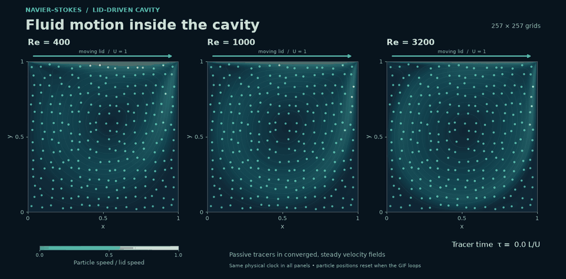
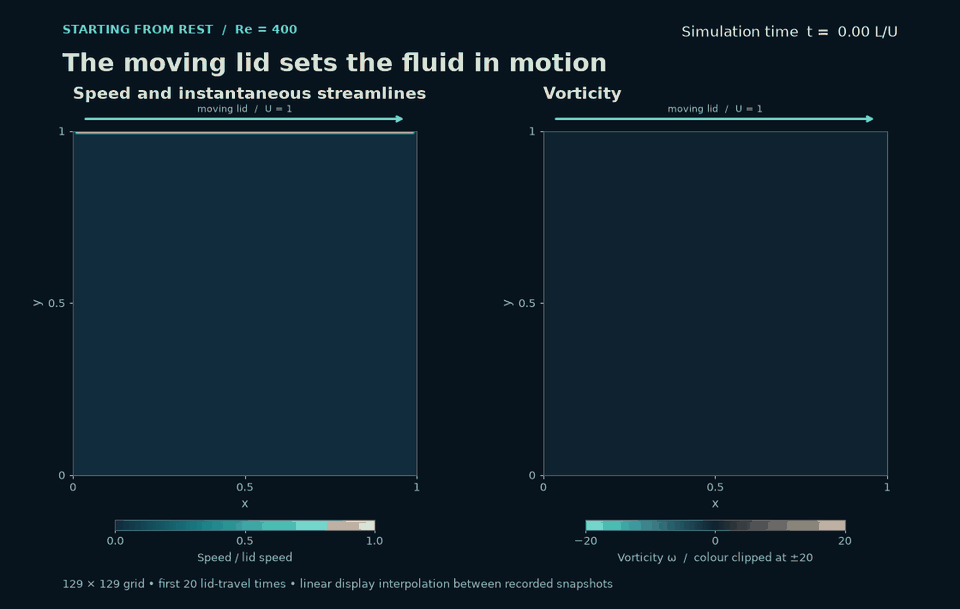
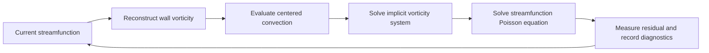

# 2D Incompressible Navier–Stokes: Lid-Driven Cavity Problem

**Fluid motion in a lid-driven cavity, computed and visualised in Python.**




*Passive tracers advected through the converged steady velocity fields on 257² grids. Colour shows speed relative to the lid velocity; all panels share the same time and colour scale. Tracer positions reset each time the animation loops.*

A square cavity is filled with fluid, and its top wall slides to the right at constant speed. Viscosity drags the adjacent fluid along, driving a large clockwise vortex and smaller counter-rotating eddies in the corners. This project solves for that flow from the 2-D incompressible Navier–Stokes equations and checks the solution through grid-refinement studies and comparison with published benchmark results.

**[Read the illustrated report](report/report.pdf)** · **[Explore the executed notebook](notebooks/lid_driven_cavity.ipynb)** · **[Inspect the reference data](docs/references.md)**

## How the circulation develops



The lid starts moving at **t = 0**. Watch motion spread from the upper wall into the interior as the main vortex forms. The left panel shows speed and instantaneous streamlines; the right shows signed vorticity, which measures local rotation. Both colour scales stay fixed throughout the sequence.

This is the **first 20 dimensionless time units of the actual Re = 400 simulation**, on a 129² grid. Recorded snapshots are interpolated in time for smooth playback; the vorticity colour scale is clipped at ±20 to reveal the interior. The calculation continues to approximately t = 61.4 before meeting the steady criterion. [How the animations are made](docs/animations.md).

<details>
<summary>Compare the final flow fields at all three Reynolds numbers</summary>


Final 257² fields at Re = 400, 1000 and 3200, using a common speed scale. All three satisfy the same steady stopping criterion. Their grid sensitivity and remaining settling are quantified below.

</details>

## The model

A viscous incompressible fluid fills a unit square. The upper wall moves right with unit speed; the other walls are stationary. In the vorticity–streamfunction formulation,

$$
\frac{\partial\omega}{\partial t}
+\frac{\partial\psi}{\partial y}\frac{\partial\omega}{\partial x}
-\frac{\partial\psi}{\partial x}\frac{\partial\omega}{\partial y}
=\frac{1}{\mathrm{Re}}\Delta\omega,
\qquad -\Delta\psi=\omega,
$$

with $u=\psi_y$, $v=-\psi_x$ and $\mathrm{Re}=UL/\nu$. The streamfunction enforces incompressibility; taking the curl removes pressure. No-slip enters through the wall vorticity.

## Numerical choices and their tradeoffs

| Choice | Why use it? | What it costs |
|---|---|---|
| Uniform finite-difference grid | Simple stencils and a separable Poisson operator | Thin wall layers need fine grids |
| Centered second-order space differences | Clear consistency analysis, little artificial diffusion | Under-resolved oscillations are possible |
| Explicit convection, implicit diffusion | Two reusable SPD linear systems per step | First-order time accuracy; lagged walls still restrict the step |
| Thom wall vorticity | Transfers the tangential no-slip condition to vorticity | First-order local wall truncation error |
| Sine-transform linear solver | Direct solution of the discrete systems in O(M log M) | Requires the uniform rectangular geometry |

Sparse LU and conjugate gradient with an incomplete-Cholesky preconditioner are also available. [The report](report/report.pdf) derives the formulas, including the wall terms and the time-step restrictions.



## Try it

From this folder, create a virtual environment and install the project:

```bash
python3 -m venv .venv
source .venv/bin/activate
python -m pip install -e ".[dev,notebook]"
python scripts/run_demo.py
```

On Windows, activate with `.venv\Scripts\Activate.ps1`. The demo runs Re = 400 on a 65² grid and writes a figure and restart checkpoint to `output/demo/`. This small run is intended for exploration; the production study uses finer grids.

The same calculation through the Python API:

```python
from ns2d import Grid, Cavity, Solver
from ns2d.postproc import primary_vortex

solver = Solver(Grid.square(65), Cavity(Re=400), backend="dst")
result = solver.run(T=80.0, steady_tol=1e-6, record=False)

print("Steady criterion met:", result.converged)
print("Final residual:", result.final_residual)
print(primary_vortex(solver.psi, solver.grid))
solver.save("checkpoint.npz")
```

## Verification: measure the approximation

The manufactured solution contains two spatial modes and moving walls, so it exercises both nonlinear convection and the lid-forcing mechanism. The spatial study runs to T = 0.5 at Re = 100, long enough for vorticity generated at the walls to diffuse into the interior; over a much shorter horizon the streamfunction error would be almost entirely the Poisson discretisation error of the initial vorticity. Separate space and time studies show approximately second-order accuracy in space for both streamfunction and vorticity, with exact and Thom wall vorticity, and first-order accuracy in time. Local Thom wall error is first order. The full sequences are retained in [verification.json](data/verification.json). An asymmetric manufactured field and a doubled-step check on the finest grid independently challenge the spatial study.

<details>
<summary>View the spatial, temporal and wall-convergence plots</summary>


</details>

Tests also check the Poisson equation, discrete divergence and circulation, agreement between the three linear solvers, instability detection, and checkpoint compatibility. These identities test algebraic consistency; they do not replace an accuracy study.

```bash
python -m pytest -q
```

## Results: compare the flow with the literature

<!-- results:start -->
| Re | Grid | Final time | Residual | Steady? | ψ minimum | Ghia difference |
|---:|---:|---:|---:|:---:|---:|---:|
| 400 | 65² | 61.12 | 9.80e-07 | yes | -0.109052 | 4.26% |
| 400 | 129² | 61.37 | 9.68e-07 | yes | -0.112776 | 0.99% |
| 400 | 257² | 61.62 | 9.88e-07 | yes | -0.113689 | 0.19% |
| 1000 | 65² | 140.00 | 9.97e-07 | yes | -0.105252 | 10.75% |
| 1000 | 129² | 149.70 | 9.98e-07 | yes | -0.115473 | 2.08% |
| 1000 | 257² | 156.40 | 9.97e-07 | yes | -0.118074 | 0.12% |
| 3200 | 129² | 510.66 | 1.00e-06 | yes | -0.109979 | 8.64% |
| 3200 | 193² | 534.75 | 1.00e-06 | yes | -0.116413 | 3.29% |
| 3200 | 257² | 543.11 | 1.00e-06 | yes | -0.118734 | 1.37% |
<!-- results:end -->

The residual is the maximum interior vorticity update divided by the time step. The stopping threshold is 10⁻⁶. “Ghia difference” is the relative difference in primary-vortex streamfunction, not an error bound for the full flow.

<details>
<summary>View the velocity profiles against the published reference stations</summary>


</details>

The references are [Ghia, Ghia & Shin (1982)](https://doi.org/10.1016/0021-9991(82)90058-4), plus [Botella & Peyret (1998)](https://doi.org/10.1016/S0045-7930(98)00002-4) at Re = 1000. Their different methods make the second comparison useful. Both sets of discrepancies are exported in [validation.json](data/validation.json). Agreement with one reference is not a continuum accuracy estimate.

**Reference anomalies stay visible.** The headline RMS includes every published station. Ghia’s printed u = −0.86636 at Re = 3200, y = 0.4531, and v = −0.23827 at Re = 400, x = 0.9063, are flagged, retained, and accompanied by secondary RMS values without those stations. They are never replaced with values fitted to this solver. [Read the source audit and coordinate conventions](docs/references.md).

### What the measurements establish

- Increasing Re sharpens the wall layers and moves the primary vortex toward the cavity centre. Secondary corner eddies become more visible.
- Three grids per Reynolds number measure spatial sensitivity. The primary-vortex strength, vortex coordinates, energy, center vorticity and a secondary eddy are assessed separately.
- Every production state reaches the same steady criterion. Two further ten-time-unit integrations, with dt and dt/2, measure the remaining drift and step sensitivity.
- The upper corners are singular. Colour limits are stated on vorticity figures; large corner values are not removed from the underlying data.
- The suggested time step combines an interior linear analysis with a small-grid Stokes wall experiment. It is not a nonlinear stability theorem.

### Grid uncertainty, time accuracy and settling

The spatial study uses 65²/129²/257² grids at Re = 400 and 1000, and 129²/193²/257² at Re = 3200. Conditional Richardson fits use the actual grid ratios. Non-monotone sequences are retained without an invented order or uncertainty estimate.

<!-- accuracy:start -->
| Re | Three-grid fitted order | Conditional GCI for ψ minimum | Ten-time-unit ψ drift |
|---:|---:|---:|---:|
| 400 | 2.027 | 0.327% | 1.830e-05% |
| 1000 | 1.974 | 0.941% | 7.603e-05% |
| 3200 | 1.917 | 3.321% | 7.843e-05% |

GCI is a conditional power-law estimate, not a rigorous bound. Settling drift is the larger change during two independent ten-time-unit continuations with dt and dt/2; it is not an infinite-time error bound.
<!-- accuracy:end -->

<details>
<summary>View the three-grid convergence plots</summary>


</details>

An additional, independent **513² run at Re = 400** tests the primary-streamfunction prediction from the first three grids. Both the predicted value and the observed change in extrapolated limit are retained in [fourth_grid.json](data/fourth_grid.json).

Independent transient runs on a fixed 129² grid, at the same T = 5, use dt, dt/2 and dt/4. Centerline self-convergence is approximately first order for all three Reynolds numbers. At an exactly stationary discrete state the time step cancels out of the fixed-point equations; the final-state half-step continuations therefore test settling sensitivity, rather than estimate a nonexistent steady backward-Euler bias.

The [accuracy evidence](data/accuracy.json) also records changes from the earlier T = 150/300 snapshots, full centerline differences, the unfiltered steady-equation defect, and sensitivity of the secondary vortex. [Study method and limitations](docs/accuracy.md).

## Reproduce and extend

The notebook runs a small example and reads the committed study evidence, so a fresh clone does not need the large simulation caches. To regenerate the full production study:

```bash
python scripts/run_production.py --force
python scripts/check_fourth_grid.py
python scripts/run_accuracy.py
python scripts/build_results.py
python scripts/build_animations.py
python scripts/build_notebook.py --execute
python scripts/build_report.py
```

The full suite can take an hour or more, depending on hardware and FFT worker count. The report build needs **Tectonic or TeX Live with XeLaTeX/LuaLaTeX**, plus **Times New Roman**; the compiled PDF is included. [The reproduction guide](docs/reproducibility.md) covers individual cases, figure builds, cache provenance and restart semantics.

| Location | Contents |
|---|---|
| [`ns2d/`](ns2d/) | Numerical solver and diagnostics |
| [`tests/`](tests/) | Numerical and API regression tests |
| [`notebooks/`](notebooks/) | Executed walkthrough |
| [`report/`](report/) | English report, LaTeX source and generated tables |
| [`figures/`](figures/) | Numerical visualisations and animation |
| [`data/`](data/) | CSV/JSON results and verification evidence |
| [`docs/code_review.md`](docs/code_review.md) | Design review, fixes and limitations |

All nine headline and refinement fields were integrated afresh from rest. Run records contain configuration, timestamps, dependency versions, numerical-source and runner fingerprints, and cache/field hashes. Result and accuracy builders reject stale or unconverged production states. Large `.npz` caches, local tooling and historical drafts are excluded from Git.

## Contributing and citation

See [CONTRIBUTING.md](CONTRIBUTING.md) for numerical-change expectations and [CITATION.cff](CITATION.cff) for citation metadata. Useful extensions include fourth-grid checks at the higher Reynolds numbers and a conservative advection option.

[MIT license](LICENSE). The original benchmark data are attributed to their respective papers.
